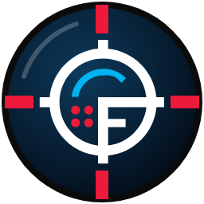
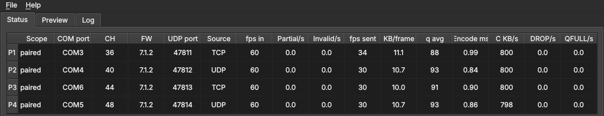
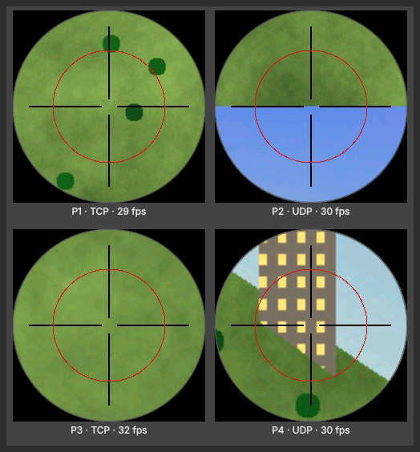
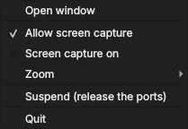
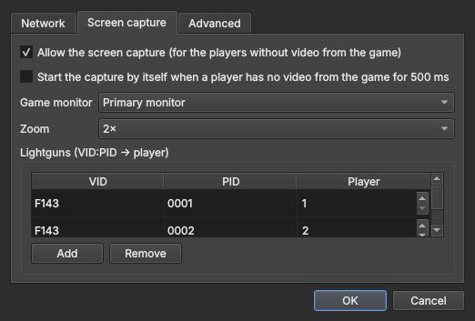

<a id="english-version"></a>

<p align="center">
  <a href="#english-version"> English Version</a> &nbsp;•&nbsp; <a href="#versione-italiana"> Versione Italiana</a>
</p>

<p align="center">
  
</p>

# OpenFIRE Scope Daemon

### Video from the PC to the OpenFIRE scopes.

The daemon runs in the notification area (the menu bar on macOS). It receives the video of each player from the games over UDP or TCP on 127.0.0.1 (or, on Windows, from a screen capture), encodes it and sends it through the USB dongles to the round display of the OpenFIRE scopes. Up to 4 players.

> **Status: in development.** Phase 6: tray icon, window, settings, log, single instance, dongles on the USB serial ports (pairing, channels, USB bandwidth), test clip, video from the games over UDP and TCP, discovery on 127.0.0.1:47810 (UDP and TCP), preview of the input and of the output, the video to the scopes (encoder, bandwidth control, pause and resend), on Windows the screen capture around the aim point of each lightgun (DXGI and Raw Input), start at login, suspension by local command, udev rule for Linux.

## Screenshots
The Status tab with four paired scopes: for each player the source (UDP or TCP), the frames per second received and sent, and the state of the radio link.
<p align="center"></p>

The Preview tab (Output): the last frames sent to the dongles, decoded as the scopes do.
<p align="center"></p>

The menu of the notification area icon and the screen capture settings (Windows).
<p align="center"> &nbsp; </p>

## Systems
 - Windows 10 (1809) or later, 64 bit.
 - Linux x86_64 and ARM64 (AppImage), X11 and Wayland.
 - macOS 12 or later (Apple Silicon and Intel).

## Command line
| Option | Meaning |
|---|---|
| `--headless` | no tray icon and no window (tests, use without a graphical interface); the log goes to the terminal |
| `--discovery-port N` | discovery port (UDP and TCP) for this run only |
| `--no-capture` | no screen capture for this run only |
| `--log FILE` | log file for this run only |
| `--play-clip FILE` | test: sends a clip (`.ofclip`) in a loop to every paired scope |

Only one daemon runs per user: starting it again opens the window of the running one.

## Games
Each player has a video port on 127.0.0.1, by default 47811-47814 for P1-P4; the same port takes the video over UDP and over TCP (TCP is for programs without UDP, such as the MAME plugin). The game asks the discovery for the ports (`WHOAMI` on 127.0.0.1:47810). The protocol, the discovery answer and ready examples for C, C++, C#, Python, JavaScript, Lua, Godot, Unity, Unreal and MAME are in [examples](examples/README.md).

## Test clip
`tools/make_clip.py` makes a clip already encoded in the scope format (Python 3 and numpy; Pillow only for `--images`), for example `python tools/make_clip.py -o test.ofclip`. `tools/test_clip.ofclip` is ready to use: `OpenFIRE-Scope-Daemon --play-clip tools/test_clip.ofclip`.

## Fake game for the bench
`of_test_sender` (built with the daemon, in the build folder) sends animated test images to the daemon over UDP, as a game would. It takes the ports from the discovery, otherwise it uses 47811-47814. Examples: `of_test_sender` (4 players, 60 fps, BGRX), `of_test_sender --players 1 --fps 30 --format rgb565`, `of_test_sender --pause-every 5 --pause-for 2 --session-every 20`. `--help` lists every option. The images appear in the Preview tab and reach the paired scopes.

## Preview
The Preview tab shows, for each player, the **Input** (the frame that enters the daemon, before the encoder) or the **Output** (the last frame sent whole to the dongle, decoded with the decoder of the scope firmware: what the scope shows when the radio loses nothing). The images are made only while the window is visible and "Show preview" is ticked.

## Start at login
Settings > Advanced > "Start at login" (off by default) starts the daemon in the notification area when the user logs in: on Windows with the `HKEY_CURRENT_USER\Software\Microsoft\Windows\CurrentVersion\Run` key, on Linux with `~/.config/autostart/openfire-scope-daemon.desktop` (it starts the AppImage file), on macOS with `~/Library/LaunchAgents/org.TeamOpenFIRE.ScopeDaemon.plist`. If the program is moved, starting it once by hand updates the entry.

## Screen capture (Windows)
For a player whose game sends no video, the daemon can capture the game monitor around the aim point. Three ticks decide when:
- "Allow screen capture" (menu, and Settings > Screen capture; on by default): without it the capture never runs.
- "Screen capture on" (menu): the capture runs only while this is ticked. It is off at every start of the daemon.
- Settings > Screen capture > "Start the capture by itself when a player has no video from the game for 500 ms" (off by default): the capture starts by itself, without "Screen capture on".

The video from a game always comes first. A local program can tick and untick "Screen capture on" with `CAPTURE;ON` and `CAPTURE;OFF` to the discovery port (UDP or TCP, only from 127.0.0.1); the answer to `WHOAMI` has `CAP=1` while the capture can run, `CAP=0` otherwise. `CAPTURE;ON` is ignored while the capture is not allowed; while the automatic start is on, "Screen capture on" is not needed (grey in the menu) and `CAPTURE;OFF` does not stop the capture.

## Suspend
Before updating the firmware of an ESP32 board through USB, choose "Suspend (release the ports)" in the menu: the daemon closes every serial port, so it cannot open the board while it is in the bootloader (there an ESP32 with native USB can have the same USB identity as the dongles). "Resume" opens them again.

A local program can do the same with a command to the discovery port (UDP or TCP, only from 127.0.0.1): `SUSPEND;T=n` releases the ports for n seconds (1-600; `SUSPEND` alone, 120 s), `RESUME` ends it before. Any other text is ignored. A suspension chosen by the user from the menu is never ended by a command.

## Linux: serial port permissions
The udev rule `linux/70-openfire-scope.rules` (in the `linux` folder of the repository and of the Linux package) lets the logged-in user open the dongles without the `dialout` group and keeps ModemManager away from them. Install it once, from the folder that holds the `linux` folder:
```
sudo cp linux/70-openfire-scope.rules /etc/udev/rules.d/
sudo udevadm control --reload-rules && sudo udevadm trigger
```
If a dongle shows "access denied", the window also shows a command to run once that writes the same rule.

## macOS: first start
The app is not signed. At the first start macOS blocks it: open System Settings > Privacy & Security (on macOS 12: System Preferences > Security & Privacy > General) and click "Open Anyway" next to the message about OpenFIRE Scope Daemon, then confirm. This is needed only once. Alternatively, in the Terminal: `xattr -dr com.apple.quarantine "/Applications/OpenFIRE-Scope-Daemon.app"`.

## Settings
The settings are in an INI file:
 - Windows: `%APPDATA%\OpenFIRE\OpenFIRE-Scope-Daemon.ini`
 - Linux and macOS: `~/.config/OpenFIRE/OpenFIRE-Scope-Daemon.ini`

The `[encoder]` section holds the constants of the encoder, written with their default value at the first start: `motionLow` and `motionHigh` (motion for 30 and 60 fps), `profile30Bytes` and `profile60Bytes` (bytes per frame), `qLow` and `qHigh` (mean q that lowers or raises the fps cap) and the cost model of the scope (`instrPerMcu`, `instrPerCoef`, `instrFixed`, `cpi`, `dmaWaitMs`, `maxCycleMs`). They are estimates to tune on the bench and apply from the next pairing. In `[threads]`, `serialPriority` (default `aboveNormal`), `udpPriority` and `encoderPriority` (default `normal`) can be `belowNormal`, `normal` or `aboveNormal`.

## Building
Qt 6.4 or later (Core, Gui, Widgets, Network, SerialPort, LinguistTools), CMake 3.21 or later, a C++17 compiler.
```
cmake -B build -DCMAKE_BUILD_TYPE=Release
cmake --build build --parallel
```
The workflows in `.github/workflows` build the Windows packages, the Linux AppImages and the macOS DMG.

## License
GNU General Public License v3.0, see [LICENSE](LICENSE).

---

<a id="versione-italiana"></a>

<p align="center">
  <a href="#english-version"> English Version</a> &nbsp;•&nbsp; <a href="#versione-italiana"> Versione Italiana</a>
</p>

<p align="center">
  
</p>

# OpenFIRE Scope Daemon

### Video dal PC ai mirini OpenFIRE.

Il demone gira nell'area di notifica (nella barra dei menu su macOS). Riceve il video di ogni giocatore dai giochi via UDP o TCP su 127.0.0.1 (oppure, su Windows, da una cattura dello schermo), lo codifica e lo manda tramite i dongle USB al display rotondo dei mirini OpenFIRE. Fino a 4 giocatori.

> **Stato: in sviluppo.** Fase 6: icona nell'area di notifica, finestra, impostazioni, registro, istanza unica, dongle sulle porte seriali USB (abbinamento, canali, banda USB), clip di prova, video dai giochi in UDP e TCP, discovery su 127.0.0.1:47810 (UDP e TCP), anteprima dell'ingresso e dell'uscita, il video ai mirini (encoder, controllo di banda, pausa e reinvio), su Windows la cattura dello schermo attorno al punto di mira di ogni lightgun (DXGI e Raw Input), avvio all'accesso, sospensione con comando locale, regola udev per Linux.

## Immagini
La scheda Stato con quattro mirini abbinati: per ogni giocatore la sorgente (UDP o TCP), i frame al secondo ricevuti e inviati e lo stato del collegamento radio.
<p align="center"></p>

La scheda Anteprima (Uscita): gli ultimi frame inviati ai dongle, decodificati come fanno i mirini.
<p align="center"></p>

Il menu dell'icona nell'area di notifica e le impostazioni della cattura dello schermo (Windows).
<p align="center"> &nbsp; </p>

## Sistemi
 - Windows 10 (1809) o successivo, 64 bit.
 - Linux x86_64 e ARM64 (AppImage), X11 e Wayland.
 - macOS 12 o successivo (Apple Silicon e Intel).

## Riga di comando
| Opzione | Significato |
|---|---|
| `--headless` | nessuna icona e nessuna finestra (prove, uso senza interfaccia grafica); il registro va nel terminale |
| `--discovery-port N` | porta di discovery (UDP e TCP) solo per questo avvio |
| `--no-capture` | nessuna cattura dello schermo solo per questo avvio |
| `--log FILE` | file di registro solo per questo avvio |
| `--play-clip FILE` | prova: manda una clip (`.ofclip`) in ciclo a ogni mirino abbinato |

Gira un solo demone per utente: avviarlo di nuovo apre la finestra di quello già attivo.

## Giochi
Ogni giocatore ha una porta video su 127.0.0.1, in partenza 47811-47814 per P1-P4; la stessa porta riceve il video in UDP e in TCP (il TCP serve ai programmi senza UDP, come il plugin di MAME). Il gioco chiede le porte alla discovery (`WHOAMI` su 127.0.0.1:47810). Il protocollo, la risposta della discovery ed esempi pronti per C, C++, C#, Python, JavaScript, Lua, Godot, Unity, Unreal e MAME sono in [examples](examples/README.md).

## Clip di prova
`tools/make_clip.py` crea una clip già codificata nel formato del mirino (Python 3 e numpy; Pillow solo per `--images`), per esempio `python tools/make_clip.py -o prova.ofclip`. `tools/test_clip.ofclip` è pronta da usare: `OpenFIRE-Scope-Daemon --play-clip tools/test_clip.ofclip`.

## Finto gioco per il banco
`of_test_sender` (compilato insieme al demone, nella cartella di build) manda al demone in UDP immagini di prova animate, come farebbe un gioco. Prende le porte dalla discovery, altrimenti usa 47811-47814. Esempi: `of_test_sender` (4 giocatori, 60 fps, BGRX), `of_test_sender --players 1 --fps 30 --format rgb565`, `of_test_sender --pause-every 5 --pause-for 2 --session-every 20`. `--help` elenca tutte le opzioni. Le immagini compaiono nella scheda Anteprima e arrivano ai mirini abbinati.

## Anteprima
La scheda Anteprima mostra, per ogni giocatore, l'**Ingresso** (il frame che entra nel demone, prima dell'encoder) o l'**Uscita** (l'ultimo frame inviato intero al dongle, decodificato con il decoder del firmware del mirino: ciò che mostra il mirino quando la radio non perde niente). Le immagini si preparano solo con la finestra visibile e "Mostra anteprima" spuntata.

## Avvio all'accesso
Impostazioni > Avanzate > "Avvia all'accesso" (spento in partenza) avvia il demone nell'area di notifica quando l'utente accede: su Windows con la chiave `HKEY_CURRENT_USER\Software\Microsoft\Windows\CurrentVersion\Run`, su Linux con `~/.config/autostart/openfire-scope-daemon.desktop` (avvia il file AppImage), su macOS con `~/Library/LaunchAgents/org.TeamOpenFIRE.ScopeDaemon.plist`. Se il programma viene spostato, avviarlo una volta a mano aggiorna la voce.

## Cattura dello schermo (Windows)
Per un giocatore il cui gioco non manda video, il demone può catturare il monitor del gioco attorno al punto di mira. Tre spunte decidono quando:
- "Permetti la cattura dello schermo" (menu, e Impostazioni > Cattura dello schermo; accesa in partenza): senza di essa la cattura non parte mai.
- "Cattura dello schermo attiva" (menu): la cattura funziona solo mentre è spuntata. È spenta a ogni avvio del demone.
- Impostazioni > Cattura dello schermo > "Avvia la cattura da sola quando un giocatore non riceve video dal gioco per 500 ms" (spenta in partenza): la cattura parte da sola, senza "Cattura dello schermo attiva".

Il video di un gioco ha sempre la precedenza. Un programma locale può mettere e togliere la spunta "Cattura dello schermo attiva" con `CAPTURE;ON` e `CAPTURE;OFF` alla porta di discovery (UDP o TCP, solo da 127.0.0.1); la risposta a `WHOAMI` ha `CAP=1` mentre la cattura può funzionare, altrimenti `CAP=0`. `CAPTURE;ON` si ignora finché la cattura non è permessa; con l'avvio automatico acceso "Cattura dello schermo attiva" non serve (grigia nel menu) e `CAPTURE;OFF` non ferma la cattura.

## Sospensione
Prima di aggiornare il firmware di una scheda ESP32 via USB, scegliere "Sospendi (rilascia le porte)" nel menu: il demone chiude tutte le porte seriali, così non può aprire la scheda mentre è nel bootloader (lì un ESP32 con USB nativa può avere la stessa identità USB dei dongle). "Riprendi" le riapre.

Un programma locale può fare lo stesso con un comando alla porta di discovery (UDP o TCP, solo da 127.0.0.1): `SUSPEND;T=n` rilascia le porte per n secondi (1-600; `SUSPEND` da solo, 120 s), `RESUME` la chiude prima. Qualsiasi altro testo si ignora. Una sospensione scelta dall'utente dal menu non la chiude mai un comando.

## Linux: permessi delle porte seriali
La regola udev `linux/70-openfire-scope.rules` (nella cartella `linux` del repository e del pacchetto per Linux) permette all'utente collegato di aprire i dongle senza il gruppo `dialout` e tiene ModemManager lontano da loro. Si installa una volta, dalla cartella che contiene la cartella `linux`:
```
sudo cp linux/70-openfire-scope.rules /etc/udev/rules.d/
sudo udevadm control --reload-rules && sudo udevadm trigger
```
Se un dongle risulta "accesso negato", la finestra mostra anche un comando da eseguire una volta che scrive la stessa regola.

## macOS: primo avvio
L'app non è firmata. Al primo avvio macOS la blocca: aprire Impostazioni di Sistema > Privacy e sicurezza (su macOS 12: Preferenze di Sistema > Sicurezza e privacy > Generali) e fare clic su "Apri comunque" accanto al messaggio su OpenFIRE Scope Daemon, poi confermare. Serve una volta sola. In alternativa, nel Terminale: `xattr -dr com.apple.quarantine "/Applications/OpenFIRE-Scope-Daemon.app"`.

## Impostazioni
Le impostazioni sono in un file INI:
 - Windows: `%APPDATA%\OpenFIRE\OpenFIRE-Scope-Daemon.ini`
 - Linux e macOS: `~/.config/OpenFIRE/OpenFIRE-Scope-Daemon.ini`

La sezione `[encoder]` contiene le costanti dell'encoder, scritte con il valore predefinito al primo avvio: `motionLow` e `motionHigh` (movimento per 30 e 60 fps), `profile30Bytes` e `profile60Bytes` (byte per frame), `qLow` e `qHigh` (q medio che abbassa o alza il tetto di fps) e il modello di costo del mirino (`instrPerMcu`, `instrPerCoef`, `instrFixed`, `cpi`, `dmaWaitMs`, `maxCycleMs`). Sono stime da tarare al banco e valgono dal prossimo abbinamento. In `[threads]`, `serialPriority` (predefinito `aboveNormal`), `udpPriority` e `encoderPriority` (predefinito `normal`) possono essere `belowNormal`, `normal` o `aboveNormal`.

## Compilazione
Qt 6.4 o successivo (Core, Gui, Widgets, Network, SerialPort, LinguistTools), CMake 3.21 o successivo, un compilatore C++17.
```
cmake -B build -DCMAKE_BUILD_TYPE=Release
cmake --build build --parallel
```
I workflow in `.github/workflows` creano i pacchetti per Windows, le AppImage per Linux e il DMG per macOS.

## Licenza
GNU General Public License v3.0, vedi [LICENSE](LICENSE).
